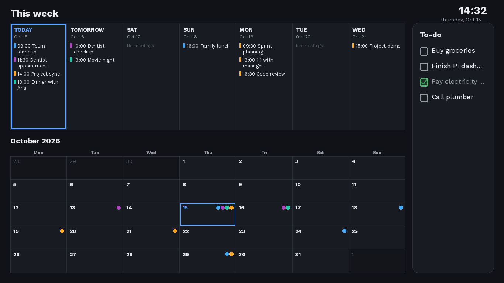

# Pi Calendar

A lightweight, read-only wall dashboard for the Raspberry Pi — built for low-power boards like the Pi Zero W that can't run a full browser or an Electron-based alternative (e.g. MagicMirror²).

Shown on any HDMI display:
- **This week** — every meeting from your calendars, listed in full, nothing truncated
- **This month** — a compact overview grid, color-coded dots per calendar source
- **To-do list** — synced from Microsoft To Do



## Why not MagicMirror² or a browser-based dashboard?

This project exists because a Raspberry Pi Zero W (single-core, 512MB RAM) can't reliably run a full Chromium/Electron session. Instead, a small Python script runs periodically, fetches your calendar and to-do data, renders a single PNG with Pillow, and a minimal framebuffer viewer (`fbi`) displays it fullscreen — no browser, no desktop environment, near-zero idle resource usage.

## Status

Working end-to-end: Microsoft To Do + one calendar, running as a systemd service on a Pi Zero W. See [docs/PLAN.md](docs/PLAN.md) for the full design history, architecture notes, and rollout phases (adding more calendars, etc.) — this README is the setup guide; PLAN.md is the project log.

## Hardware

- A Raspberry Pi — built and tested on a **Pi Zero W, Rev 1.1** (single-core ARMv6). Anything newer/more powerful also works, it's just overkill for this.
- A microSD card (8GB+) and, if your PC has no built-in slot, a USB card reader
- Any HDMI-capable display (an old laptop monitor or TV works fine) and the right HDMI cable/adapter for your Pi model
- A 5V power supply for the Pi

## 1. Flash the SD card

Use [Raspberry Pi Imager](https://www.raspberrypi.com/software/) (free, Windows/Mac/Linux).

1. Insert the SD card into your PC (via a USB reader if needed).
2. Open Raspberry Pi Imager.
3. **Choose Device** → select your Pi model (e.g. "Raspberry Pi Zero W").
4. **Choose OS** → **Raspberry Pi OS (other)** → **Raspberry Pi OS Lite**. If your board is single-core/ARMv6 (Pi Zero/Zero W/1/2 non-"2 W"), you need the **32-bit** build — the 64-bit Lite image won't boot on it.
5. **Choose Storage** → select your SD card. (You don't need to separately "erase" an existing install first — writing a new image overwrites everything on the card regardless of what's currently on it.)
6. Click the gear/**Edit Settings** icon before writing, and fill in the **General** tab:
   - Hostname (e.g. `pi-calendar`)
   - Username and password — Raspberry Pi OS no longer ships a default `pi` user/password, so pick your own (e.g. `calendar`). **Remember this username** — you'll need it later when editing the systemd service files.
   - Wi-Fi SSID + password, and your locale/timezone
   - On the **Services** tab: enable SSH, and choose "Use password authentication"
7. Save, then **Write**. Wait for it to finish verifying.
8. Move the SD card to the Pi, connect HDMI + power, and wait a minute or two for first boot. Then SSH in from your computer:
   ```bash
   ssh <your-username>@<hostname>.local
   ```
   (or use the Pi's IP address if `.local` mDNS resolution doesn't work on your network).

## 2. Get a calendar as an ICS link

The dashboard reads calendars as plain `.ics` feed URLs — no API keys needed for this part. Get one (or more) of these:

**Outlook.com / Microsoft personal account:**
Settings → **Calendar** → **Shared calendars** → **Publish a calendar** → pick the calendar → permission **"Can view all details"** → **Publish** → copy the **ICS** link shown. (This is different from "Share calendar", which invites specific people — you want *Publish*, which gives a public read-only link anyone with it can fetch.)

**Google Calendar:**
Google Calendar (web) → Settings (gear icon) → click your calendar under "Settings for my calendars" → **Integrate calendar** → copy the **"Secret address in iCal format"**. Treat this URL as a secret — it grants read access to that calendar's full details.

**Yahoo Calendar:**
Yahoo Calendar → Settings → Calendars → select the calendar → Share → generate/share an ICS link. (Yahoo's exact wording for this has changed over the years; look for "share" or "export" options on the calendar.)

Each calendar you add gets its own line in `config.yaml` with a name, URL, and accent color (see step 4).

## 3. Register an Azure app for Microsoft To Do

Microsoft To Do doesn't have a public ICS feed, so this part goes through the Microsoft Graph API instead, using OAuth2 **device-code flow** — you sign in once via a browser, and no client secret is ever stored on the Pi.

1. Go to [entra.microsoft.com](https://entra.microsoft.com) and sign in with the Microsoft account whose To Do list you want to show.
   - **If you hit an `AADSTS16000` error** ("need admin approval" / unrecognized tenant): your personal account doesn't have a real Entra directory provisioned yet. Fix this by signing up for a free Azure account at [azure.microsoft.com/free](https://azure.microsoft.com/free) with that same account — it auto-provisions a real directory, and the free tier is all you need (no paid subscription required for app registrations). A card may be requested during signup, but nothing here will trigger any charges.
2. In Entra, go to **App registrations** → **New registration**.
   - Name: anything (e.g. "Pi Calendar")
   - Supported account types: **Personal Microsoft accounts only**
   - Redirect URI: leave blank
   - Register.
3. Copy the **Application (client) ID** shown on the app's Overview page — you'll need this for `config.yaml`.
4. Go to **Authentication** (may be labeled "Authentication (Preview)") → **Settings** tab → make sure **"Allow public client flows"** is set to **Enabled**.
5. Go to **API permissions** → **Add a permission** → **Microsoft Graph** → **Delegated permissions** → search for and check **Tasks.ReadWrite** → **Add permissions**. (No admin consent step is needed for a personal/MSA account.)

That's it — no client secret to generate or store.

## 4. Configure the dashboard

On your own computer (or directly on the Pi), copy the example config and fill in your real values:

```bash
cp config.example.yaml config.yaml
```

Edit `config.yaml`:
- Add a `calendars` entry for each ICS link from step 2, with a name and accent color
- Set `microsoft_todo.client_id` to the Application (client) ID from step 3
- Set `display.width` / `display.height` to your monitor's native resolution

`config.yaml` is listed in `.gitignore` — it holds your real links and ID, so it's never committed to the repo.

## 5. Install on the Pi

SSH into the Pi, then:

```bash
git clone https://github.com/SlobodanKuzmanovic/pi_calendar.git
cd pi_calendar
sudo apt update && sudo apt install -y python3-pip fbi
sudo pip3 install -r requirements.txt --break-system-packages
```

Use `sudo pip3 install` (not a plain user-level `pip install`) — the dashboard runs as a systemd service under the root user, which can't see packages installed into a regular user's own site-packages.

If you built `config.yaml` on your own computer, copy it to the Pi now (e.g. `scp config.yaml <user>@<host>.local:~/pi_calendar/`); otherwise create it directly on the Pi as in step 4.

Run the script once by hand to do the one-time Microsoft sign-in and confirm it works:

```bash
python3 dashboard/main.py
```

The first run prints a URL and a short code — open the URL on any device (phone, laptop), enter the code, and sign in with the Microsoft account from step 3. After that, tokens refresh automatically and you won't be prompted again. Confirm `dashboard/current.png` now exists and looks right.

## 6. Run it automatically

The `systemd/` folder has two services (render the image on a timer, and display it fullscreen) plus the timer itself.

**Important:** the shipped service files assume your Pi username is `calendar` (as set up in step 1). If you used a different username, edit `systemd/dashboard-render.service` and `systemd/dashboard-display.service` first and replace `/home/calendar/` with your own home directory.

```bash
sudo cp systemd/dashboard-render.service systemd/dashboard-render.timer systemd/dashboard-display.service /etc/systemd/system/
sudo systemctl daemon-reload
sudo systemctl enable --now dashboard-render.timer
sudo systemctl enable --now dashboard-display.service
```

Also disable the default login prompt on the console, since it competes with the dashboard for the screen:

```bash
sudo systemctl disable --now getty@tty1.service
```

Check status:

```bash
sudo systemctl status dashboard-render.service
sudo systemctl status dashboard-display.service
```

Both should show `active`/recent clean exits, with no restart loop. Reboot (`sudo reboot`) and confirm the dashboard comes back up on its own.

## Troubleshooting

- **Screen stays on the text console / login prompt**: `getty@tty1.service` is still fighting `fbi` for the screen — run `sudo systemctl disable --now getty@tty1.service`, then `sudo systemctl restart dashboard-display.service`.
- **Screen is black, or `dashboard-display.service`'s restart counter keeps climbing**: `fbi` can exit shortly after drawing the image when run under systemd without a real controlling terminal, and with `Restart=always` that turns into a crash loop that corrupts the framebuffer. The shipped service file already works around this (`StandardInput=tty`/`StandardOutput=tty`/`TTYPath=/dev/tty1`, plus wrapping the command so the service stays "running" after `fbi` draws the image instead of being restarted) — if you're hitting this, make sure you copied the current version of `systemd/dashboard-display.service` rather than an older copy.
- **Screen goes black after sitting for a while, even though the service looks healthy**: this is likely the console's idle screen-blanking, not the dashboard. Disable it with `sudo raspi-config nonint do_blanking 1` and/or add `consoleblank=0` to `/boot/cmdline.txt`.
- **`dashboard-render.service` fails with `status=200/CHDIR`**: the `WorkingDirectory`/paths in the service file point at a username that doesn't exist on your Pi — edit `/home/calendar/` to match your actual username (see step 6).
- **Render log says calendar/To-Do libraries aren't installed**, even though you ran `pip install`: you installed them without `sudo`, so the root-run service can't see them — reinstall with `sudo pip3 install -r requirements.txt --break-system-packages`.

## License

MIT — see [LICENSE](LICENSE).
